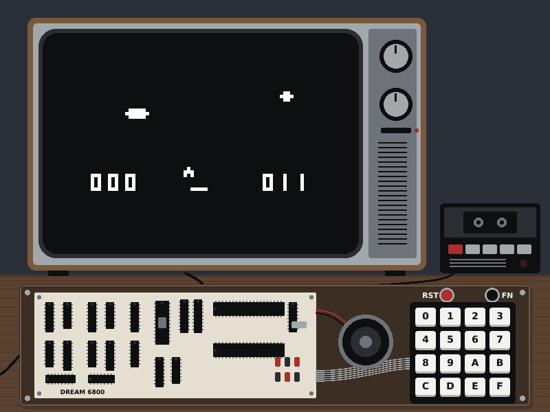

# DREAM 6800 per MiSTer

Una ricostruzione in FPGA del **DREAM 6800**, il computer per hobbisti progettato da
**Michael J. Bauer** e pubblicato nel 1979 dalla rivista australiana *Electronics Australia*, per
la piattaforma [MiSTer](https://github.com/MiSTer-devel). DREAM sta per *Domestic Recreational
Educational and Adaptive Microcomputer*: un piccolo computer con Motorola 6800 da costruire da sé,
con un tastierino esadecimale, un televisore come schermo, un registratore a cassette per i
programmi e **CHIPOS**, un monitor da 1 KB con un interprete **CHIP-8**, così che giravano anche i
giochi scritti per l'RCA COSMAC VIP.

Il core è la macchina intera in linguaggio di descrizione dell'hardware, con i tempi di quella
vera: il circuito video legge lo schermo dalla memoria fermando la CPU, esattamente come
sull'originale, quindi i giochi vanno alla loro velocità reale. Si può guardare come semplice
immagine del televisore (15 kHz, per i CRT) oppure come disegno della macchina sulla scrivania,
con i tasti cliccabili col mouse.



*English: [README.md](README.md).*

---

## La macchina

### Un po' di storia

Michael Bauer ha progettato il DREAM come una macchina che un hobbista potesse costruire con
componenti comuni e usare per giocare e per imparare, e l'ha pubblicato su *Electronics Australia*
in quattro puntate, da **maggio ad agosto 1979**. Un'espansione di memoria a 4 KB è seguita nel
dicembre 1980.

Il progetto è molto semplice: un **Motorola MC6800** a 1 MHz, un'interfaccia parallela **MC6821**
per tastierino, cassetta e suono, 1 KB di RAM (fino a 4 KB) e il programma CHIPOS da 1 KB in una
EPROM. L'immagine la fa una manciata di chip TTL: 64×32 punti, letti dalla memoria in DMA e
mostrati su un normale televisore. I programmi si salvavano su cassetta audio a 300 baud.

La parte software è **CHIP-8**, il linguaggio interpretato creato da Joseph Weisbecker alla RCA per
il COSMAC VIP (1977). Bauer ha scritto CHIPOS perché i programmi CHIP-8 girassero sul 6800, e gli
utenti si scambiavano giochi e programmi con la newsletter **DREAMER** (1980–82). La macchina è
ricordata ancora oggi: Bauer tiene un archivio degli articoli, del sorgente di CHIPOS e dei suoi
programmi sul [suo sito](https://www.mjbauer.biz/DREAM6800.htm), e se ne costruiscono riproduzioni
come la [re-creation di Digicool Things](https://digicoolthings.com/dream-6800-6809-re-creation-part-1/).

### Le sue parti

| Parte | Dettagli |
|---|---|
| CPU | MC6800, quarzo da 4 MHz / 4 = **1 MHz** (generatore di clock MC6875) |
| Memoria | RAM da `0000` (1, 2 o 4 KB). `0100–01FF` è lo schermo, i programmi CHIP-8 partono da `0200`. CHIPOS (1 KB) a `C000`, ripetuto fino a `FFFF` |
| Video | 64×32 punti, PAL 50 Hz. Mentre disegna le 128 righe dell'immagine il circuito video **ferma la CPU**, che in media va quindi a circa 590 kHz |
| Tastierino | 16 tasti esadecimali sulla porta A della PIA, più **FN** e **RST** (reset) |
| Suono | NE556 a 1200 o 2400 Hz, su un piccolo altoparlante |
| Cassetta | standard Kansas City, 300 baud: 2400 Hz = 1, 1200 Hz = 0, senza intestazione né checksum |
| Orologio | un interrupt per fotogramma (50 Hz), per i timer del CHIP-8 |

## Il core

| Modulo | |
|---|---|
| `rtl/dream6800.sv` | La macchina: CPU, CHIPOS, RAM, PIA, video con DMA, matrice del tastierino, suono NE556, ingresso cassetta (col monostabile da 312 µs del demodulatore originale). |
| `rtl/d6800_input.sv` | Tastiera del PC e joystick sul tastierino esadecimale; digita la sequenza di avvio dopo un caricamento rapido. |
| `rtl/d6800_desk.sv` | La vista Desk, 800×600: disegno della macchina, immagine del televisore, tasti premuti, LED del registratore, mouse. |
| `rtl/cpu68.vhd`, `rtl/pia6821.vhd` | MC6800 e MC6821 di John E. Kent (dai core arcade Williams del MiSTer), con una correzione per HALT (vedi sotto). |

### Installazione

1. Copiare `releases/DREAM6800_<data>.rbf` in `/media/fat/_Computer/` sulla SD del MiSTer, oppure aggiungere il
   database [aminta/MiSTer_aminta_db](https://github.com/aminta/MiSTer_aminta_db) (`.ini` pronto o due righe in
   `downloader.ini`, vedi il suo README): *update* e *update_all* installano e aggiornano il core.
2. Serve **CHIPOS** come `boot.rom`: scaricare `Dream6800_CHIPOS_code.zip` dalla
   [pagina del DREAM 6800 di Michael Bauer](https://www.mjbauer.biz/DREAM6800.htm), prendere
   l'immagine della ROM da 1 KB (CRC32 `3f97ca2e`, la stessa di `d6800.bin` di MAME) e salvarla come
   `/media/fat/games/DREAM6800/boot.rom`.
3. Mettere i programmi in `/media/fat/games/DREAM6800/` (anche in sottocartelle). I programmi di
   Bauer sono sulla stessa pagina come registrazioni audio (`dream6800_programs_mp3.zip`):
   `tools/tape2bin.py` li trasforma in file che il core carica (vedi *Programmi da cassetta*), oppure
   si possono suonare nell'ingresso audio del MiSTer.

### Uso

All'accensione CHIPOS mostra l'indirizzo `0000` in fondo allo schermo e aspetta comandi dal
tastierino.

**Tasti**

| PC | DREAM |
|---|---|
| `0`–`9`, `A`–`F` (riga principale o tastierino numerico) | tasti esadecimali |
| `Spazio`, `Shift` | **FN** |
| `Esc` | **RST** |
| Frecce | come il joystick (vedi *Joystick*) |
| Mouse (vista Desk) | clic su un tasto, FN o RST del disegno; il tasto resta premuto finché si tiene premuto il pulsante |

**Comandi di CHIPOS**

| Tasti | |
|---|---|
| 4 cifre esadecimali | imposta l'indirizzo corrente (mostrato dopo la 4ª cifra) |
| `FN 0` | modifica della memoria: 2 cifre per byte, `FN` salta un byte |
| `FN 1` / `FN 2` | carica / salva su nastro la memoria tra gli indirizzi scritti in `0002` (inizio) e `0004` (fine + 1) |
| `FN 3` | esegue dall'indirizzo corrente |
| `RST`, `C000`, `FN 3` | avvia il programma CHIP-8 da `0200` |

**Menu OSD** (in inglese)

| Voce | |
|---|---|
| Load program | `.c8` / `.ch8` (CHIP-8) o `.bin` (codice macchina 6800), caricati da `0200`; `.d68`, un'immagine di memoria: indirizzo di caricamento e di avvio (2 byte ciascuno, prima il byte alto) seguiti dai dati, per i programmi che non partono da `0200` (molti programmi di DREAMER usano `0080–03FF`). Il core resetta la macchina e digita da solo l'indirizzo di avvio e `FN 3`: `C000` per il CHIP-8, `0200` per i `.bin` |
| RAM | 4K (predefinita), 2K, 1K |
| Speed | *Original*, oppure *Turbo*: la CPU non viene fermata durante l'immagine, i giochi vanno circa 1,7 volte più veloci |
| Joystick | *2 4 6 8 / 5*: su 2, sinistra 4, destra 6, giù 8, fuoco 5 (quasi tutti i giochi CHIP-8); *0 1 / 3*: sinistra 0, destra 1, fuoco 3 (Dream Invaders); *Bauer stick / F*: il joystick analogico di Michael Bauer (vedi sotto), fuoco = tasto F; *Off*. Pulsanti: Fire, FN, RST |
| View | *TV*: l'immagine nativa PAL a 15 kHz, per i CRT e lo scaler; *Desk*: la macchina disegnata a 800×600 (31 kHz) |
| Phosphor | bianco, verde o ambra |
| TV border | *Full*: tutta l'immagine del televisore col bordo nero, o *Picture only*: solo i 64×32 punti |
| Scanlines, Aspect ratio, Scale | le solite opzioni video del MiSTer (vista TV) |
| Volume, Tape sound | con *Tape sound On* si sente il segnale della cassetta durante caricamento e salvataggio |
| Reset (RST) | il tasto RST |

**Programmi da cassetta.** Le registrazioni di Bauer sono tutte programmi CHIP-8 (caricati da
`0200`, avviati da `C000`) tranne Dream Invaders (codice macchina, caricato e avviato da `0200`).
Si convertono e si chiamano `.c8` i programmi CHIP-8, `.bin` il codice macchina:

```
tools/tape2bin.py UFO_Intercept.mp3 "UFO Intercept.c8"
tools/tape2bin.py dream_invaders_0200.mp3 "Dream Invaders.bin"
```

**Cassette vere.** Collegare un registratore, un telefono o un PC all'ingresso audio del MiSTer
(ADC). Scrivere inizio e fine + 1 da `0002`: per esempio `0002 FN 0 02 00 07 00`, poi `RST`, `FN 1`,
e far partire il nastro. Lo schermo si spegne mentre CHIPOS legge il nastro, come sull'originale. Per
salvare: stessi indirizzi, `FN 2`, e registrare l'uscita audio del MiSTer.

**Il joystick di Bauer.** Nel n. 3 di DREAMER (1980) Bauer pubblicò un controller per joystick: due
monostabili in un 4013, collegati alle linee libere della PIA (avviati da PB5, letti su PB1 e PB2), e
una routine che mette la posizione della leva nelle variabili CHIP-8 VC (0–63) e VD (0–31) ogni
quattro fotogrammi. Giochi come Astro-Fighter, Chase, Sheepdog, Rescue Mission e Time Trial ne hanno
bisogno. Il core ha il controller; con *Joystick: Bauer stick / F* una levetta analogica imposta la
posizione direttamente, mentre la croce o le frecce la spostano e la lasciano dov'è.

**Avvio da file.** I file MGL in `tools/mgl/` avviano un programma direttamente dal menu del MiSTer.

### I programmi della newsletter DREAMER

La newsletter degli utenti del DREAM 6800, il *DREAMER* (1980–82), stampò decine di giochi come listati
esadecimali da battere a mano. Circa 80, trascritti dalle scansioni e provati in una simulazione della
macchina, sono su **[DREAMER programs for the DREAM 6800](https://aminta.github.io/DREAM6800_Programs/)**:
una pagina per gioco con schermate, tasti, fonte (numero, pagina, autore) e correzioni fatte al listato
stampato. Basta scaricare i file `.c8` / `.d68` in `games/DREAM6800` e caricarli dall'OSD.

## Come è stato fatto

### Fonti

- I quattro articoli di *Electronics Australia* (1979) e l'espansione di RAM (1980), lo schema dei
  tempi video di Bauer e il sorgente di CHIPOS, tutti da [mjbauer.biz](https://www.mjbauer.biz/DREAM6800.htm).
- Il driver `d6800` di MAME (Robbbert), usato come riferimento per tutti i test.
- Le fotografie del prototipo, per la vista Desk.

### Fedeltà

Il core mantiene i tempi della macchina vera: 128 punti per riga a 2 MHz, 312 righe per
fotogramma (50,08 Hz), CPU ferma durante le 128 righe dell'immagine. I test in `tb/` eseguono le
stesse sequenze di tasti nella simulazione Verilator del core e in MAME e confrontano schermate e
velocità: avvio di CHIPOS, modifica della memoria, Dream Invaders, un ciclo di temporizzazione
CHIP-8 (212 tick dell'orologio contro 211 in MAME), salvataggio e caricamento su nastro in anello, la
registrazione originale di Bauer di Dream Invaders, anche attraverso un modello dell'ingresso audio
del MiSTer.

Il 6800 di John E. Kent aveva una differenza dal chip vero che solo il DREAM mette in luce: quando
HALT arrivava dopo il prelievo di un codice operativo, quel codice veniva eseguito due volte. Qui il
prelievo viene scartato (`rtl/cpu68.vhd`, documentato nell'intestazione).

L'ingresso della cassetta ricostruisce il segnale come un'onda quadra simmetrica prima del
demodulatore, perché l'ingresso audio del MiSTer vede solo la metà positiva dell'onda. In
simulazione la registrazione di Bauer si carica da circa 0,2 V di picco in su.

## Compilazione

Quartus Prime Lite 17.0.2 (gli script usano l'immagine Docker `theypsilon/quartus-lite-c5`):

```
tools/build_core.sh          # output_files/DREAM6800.rbf
make -C tb test              # simulazione Verilator contro MAME (servono CHIPOS e la ROM d6800 di MAME)
make -C tb desk              # un fotogramma della vista Desk, confrontato con art/desk_expect.png
```

`sim/gen/*.v` sono CPU e PIA in VHDL convertiti in Verilog per Verilator (`sim/gen.sh`, GHDL in
Docker).

L'immagine è generata: `art/make_svg.py` disegna la scena, `art/build_assets.py` la trasforma in
tile 8×8 a 16 colori, una mappa delle tile e i rettangoli dei tasti usati dall'hardware. Il
rendering usa solo i font liberi in `art/fonts` tramite `art/rsvg.sh`:

```
cd art && python3 make_svg.py bg.svg --bg && ./rsvg.sh bg.svg -o bg.png && python3 build_assets.py
```

## Riconoscimenti

Macchina, CHIPOS e programmi: Michael J. Bauer, 1979 (*Electronics Australia*).
CHIP-8: Joseph Weisbecker (RCA, 1977).
Core MC6800 e MC6821: John E. Kent. Driver `d6800` di MAME: Robbbert.
Puntatore del mouse dal core PLATO. Core: aminta, con Claude (Anthropic).

## Licenza

GPL-2.0, come il framework MiSTer in `sys/` e i core di CPU e PIA. CHIPOS e i programmi del DREAM
sono opera di Michael Bauer e non sono inclusi.

## Font

Le immagini generate usano solo font liberi, in `art/fonts/` con le loro licenze:
DejaVu Sans (licenza Bitstream Vera / DejaVu) e PT Mono (ParaType, SIL Open Font License 1.1).
