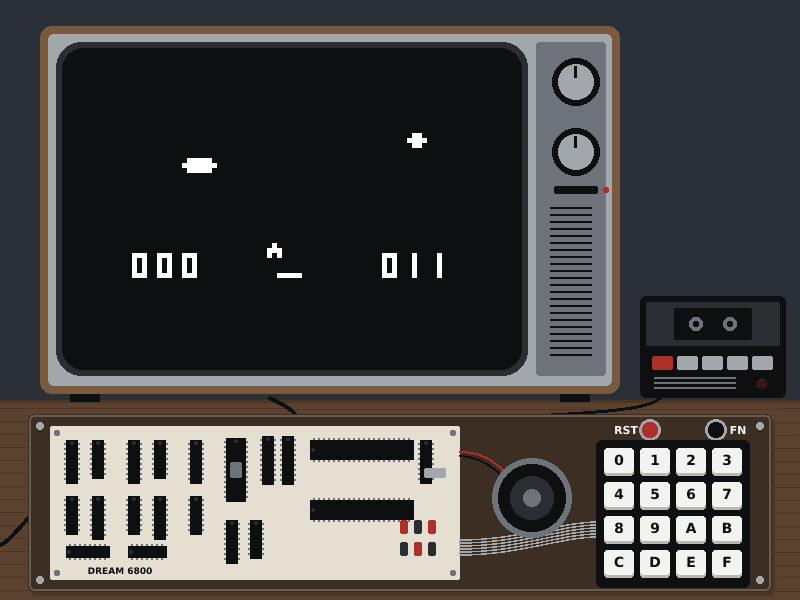

# DREAM 6800 for MiSTer

An FPGA recreation of the **DREAM 6800**, the hobby computer designed by **Michael J. Bauer** and
published in the Australian magazine *Electronics Australia* in 1979, for the
[MiSTer](https://github.com/MiSTer-devel) platform. DREAM stands for *Domestic Recreational
Educational and Adaptive Microcomputer*: a small Motorola 6800 machine you built yourself, with a
hex keypad, a TV as display, a cassette recorder for programs and **CHIPOS**, a 1 KB monitor with a
**CHIP-8** interpreter, so that the games written for the RCA COSMAC VIP ran on it too.

The core is the whole machine in hardware description language, with the timing of the real
one: the video circuit reads the screen from memory by stopping the CPU, exactly as on the
original, so games run at their real speed. You can look at it as a plain TV picture (15 kHz,
for CRTs) or at a drawing of the machine on a desk, with keys you can click with the mouse.



*Italiano: [README.it.md](README.it.md).*

---

## The machine

### A bit of history

Michael Bauer designed the DREAM as a machine that a hobbyist could build from common parts and
use for games and for learning, and published it in *Electronics Australia* in four parts, from
**May to August 1979**. A 4 KB memory expansion followed in December 1980.

The DREAM is a very simple design: a **Motorola MC6800** at 1 MHz, an **MC6821** parallel
interface for the keypad, the cassette and the sound, 1 KB of RAM (up to 4 KB) and the 1 KB
CHIPOS program in an EPROM. The picture is made by a handful of TTL chips: 64×32 dots, read
from memory by DMA, shown on an ordinary TV. Programs were saved on audio cassette at 300 baud.

Its software side is **CHIP-8**, the interpreted language created by Joseph Weisbecker at
RCA for the COSMAC VIP (1977). Bauer wrote CHIPOS so that CHIP-8 programs run on the 6800, and
users shared games and utilities through the **DREAMER** newsletter (1980–82). The machine is still
remembered: Bauer keeps an archive of the articles, the CHIPOS source and his
programs on [his website](https://www.mjbauer.biz/DREAM6800.htm), and reproductions such as the
[Digicool Things re-creation](https://digicoolthings.com/dream-6800-6809-re-creation-part-1/)
are being built today.

### Its parts

| Part | Details |
|---|---|
| CPU | MC6800, 4 MHz crystal / 4 = **1 MHz** (MC6875 clock generator) |
| Memory | RAM from `0000` (1, 2 or 4 KB). `0100–01FF` is the screen, CHIP-8 programs start at `0200`. CHIPOS (1 KB) at `C000`, repeated up to `FFFF` |
| Video | 64×32 dots, PAL 50 Hz. While it draws the 128 lines of the picture, the video circuit **halts the CPU**, which then runs at about 590 kHz on average |
| Keypad | 16 hex keys on the PIA's port A, plus **FN** and **RST** (reset) |
| Sound | NE556 at 1200 or 2400 Hz, through a small speaker |
| Cassette | Kansas City standard, 300 baud: 2400 Hz = 1, 1200 Hz = 0, no header and no checksum |
| Clock | one interrupt per frame (50 Hz), for the CHIP-8 timers |

## The core

| Module | |
|---|---|
| `rtl/dream6800.sv` | The machine: CPU, CHIPOS, RAM, PIA, video with DMA, keypad matrix, NE556 sound, cassette input (with the 312 µs one-shot of the original demodulator). |
| `rtl/d6800_input.sv` | PC keyboard and joystick on the hex keypad; types the start sequence after a quick load. |
| `rtl/d6800_desk.sv` | The Desk view, 800×600: drawing of the machine, the TV picture, keys pressed, tape LED, mouse. |
| `rtl/cpu68.vhd`, `rtl/pia6821.vhd` | MC6800 and MC6821 by John E. Kent (from the MiSTer Williams arcade cores), with a fix for HALT (see below). |

### Installing

1. Copy `releases/DREAM6800_<date>.rbf` to `/media/fat/_Computer/` on the MiSTer SD card, or add the database
   [aminta/MiSTer_aminta_db](https://github.com/aminta/MiSTer_aminta_db) (drop-in `.ini` or two lines in
   `downloader.ini`, see its README): *update* and *update_all* then install and update the core.
2. **CHIPOS is built in**, with Michael Bauer's permission: nothing else to install. A
   `/media/fat/games/DREAM6800/boot.rom` (1 KB), if present, replaces it, e.g. to try a modified
   monitor; the original is CRC32 `3f97ca2e`, the same as MAME's `d6800.bin`.
3. Put your programs in `/media/fat/games/DREAM6800/` (any sub-folder). Bauer's own programs are
   on the same page as audio recordings (`dream6800_programs_mp3.zip`): `tools/tape2bin.py`
   turns them into files the core loads (see *Programs from tape* below), or play them into the
   MiSTer's audio input.

### Using it

At power-on CHIPOS shows the address `0000` at the bottom of the screen and waits for commands
on the keypad.

**Keys**

| PC | DREAM |
|---|---|
| `0`–`9`, `A`–`F` (main row or numeric keypad) | hex keys |
| `Space`, `Shift` | **FN** |
| `Esc` | **RST** |
| Arrows | as the joystick (see *Joystick*) |
| Mouse (Desk view) | click a key, FN or RST on the drawing; the key stays down while the button is held |

**CHIPOS commands**

| Keys | |
|---|---|
| 4 hex digits | set the current address (shown after the 4th digit) |
| `FN 0` | memory modify: 2 digits per byte, `FN` skips a byte |
| `FN 1` / `FN 2` | load / save the memory between the addresses at `0002` (start) and `0004` (end + 1) from / to tape |
| `FN 3` | run from the current address |
| `RST`, `C000`, `FN 3` | start the CHIP-8 program at `0200` |

**OSD menu**

| Option | |
|---|---|
| Load program | `.c8` / `.ch8` (CHIP-8) or `.bin` (6800 machine code), loaded at `0200`; `.d68`, a memory image: load address and run address (2 bytes each, high byte first) followed by the data, for programs that do not start at `0200` (many DREAMER programs use `0080–03FF`). The core resets the machine and types the run address and `FN 3` for you: `C000` for CHIP-8, `0200` for `.bin` |
| RAM | 4K (default), 2K, 1K |
| Speed | *Original*, or *Turbo*: the CPU is not halted during the picture, games run about 1.7 times faster |
| Joystick | *2 4 6 8 / 5*: up 2, left 4, right 6, down 8, fire 5 (most CHIP-8 games); *0 1 / 3*: left 0, right 1, fire 3 (Dream Invaders); *Bauer stick / F*: Michael Bauer's analog joystick (see below), fire = key F; *Off*. Buttons: Fire, FN, RST |
| View | *TV*: the native 15 kHz PAL picture, for CRTs and the scaler; *Desk*: the drawn machine at 800×600 (31 kHz) |
| Phosphor | white, green or amber |
| TV border | *Full* TV picture with its black border, or *Picture only* (the 64×32 dots) |
| Scanlines, Aspect ratio, Scale | the usual MiSTer video options (TV view) |
| Volume, Tape sound | *Tape sound On* lets you hear the cassette signal while loading or saving |
| Reset (RST) | the RST key |

**Programs from tape.** Bauer's recordings are all CHIP-8 programs (load at `0200`, run at `C000`)
except Dream Invaders (machine code, load and run at `0200`). Convert them and name CHIP-8 programs
`.c8`, machine code `.bin`:

```
tools/tape2bin.py UFO_Intercept.mp3 "UFO Intercept.c8"
tools/tape2bin.py dream_invaders_0200.mp3 "Dream Invaders.bin"
```

**Real tapes.** Connect a cassette player, phone or PC to the MiSTer's audio input (ADC). Write the
start and the end + 1 at `0002`: e.g. `0002 FN 0 02 00 07 00`, then `RST`, `FN 1`, and play. The
screen goes blank while CHIPOS reads the tape, as on the original. To save, set the same addresses,
press `FN 2` and record the MiSTer's audio output.

**Bauer's joystick.** In DREAMER no. 3 (1980) Bauer published a joystick controller: two one-shots in a
4013 chip, plugged into the spare lines of the PIA (triggered by PB5, read on PB1 and PB2), and a
service routine that puts the stick position in the CHIP-8 variables VC (0–63) and VD (0–31) every
fourth frame. Games such as Astro-Fighter, Chase, Sheepdog, Rescue Mission and Time Trial
need it. The core has the controller; with *Joystick: Bauer stick / F* an analog stick sets the
position directly, and the d-pad or the arrow keys move it and leave it where it is.

**Launching from a file.** MGL files in `tools/mgl/` start a program directly from the MiSTer menu.

### Programs from the DREAMER newsletter

The DREAM 6800 users' newsletter, the *DREAMER* (1980–82), printed dozens of games as hex listings to
type in. About 80 of them, transcribed from the scans and checked in a simulation of the machine, are
on **[DREAMER programs for the DREAM 6800](https://aminta.github.io/DREAM6800_Programs/)**: one page
per game with screenshots, keys, the source (issue, page, author) and the corrections applied to the
printed listing. Download the `.c8` / `.d68` files into `games/DREAM6800` and load them from the OSD.

## How it was made

### Sources

- The four *Electronics Australia* articles (1979) and the RAM expansion (1980), Bauer's video timing
  diagram and the CHIPOS source code, all from [mjbauer.biz](https://www.mjbauer.biz/DREAM6800.htm).
- The MAME `d6800` driver (Robbbert), used as the reference for every test.
- Photographs of the prototype for the Desk view.

### Accuracy

The core keeps the timing of the real machine: 128 dots per line at 2 MHz, 312 lines per frame
(50.08 Hz), the CPU halted during the 128 lines of the picture. The tests in `tb/` run the same key
sequences in the Verilator simulation of the core and in MAME and compare the screens and the speed:
CHIPOS start-up, memory modify, Dream Invaders, a CHIP-8 timing loop (212 vs 211 clock ticks in
MAME), tape save and load in a loop, Bauer's original recording of Dream Invaders, also through a
model of the MiSTer's audio input.

The 6800 by John E. Kent had one difference from the real chip that only the DREAM shows: when HALT
arrived after an opcode had been fetched, the opcode was executed a second time. Here the fetch is
dropped (`rtl/cpu68.vhd`, documented in its header).

The tape input rebuilds the signal as a symmetric square wave before the demodulator, because the
MiSTer's audio input only sees the positive half of the wave. In simulation Bauer's recording loads
from about 0.2 V peak upwards.

## Building

Quartus Prime Lite 17.0.2 (the scripts use the Docker image `theypsilon/quartus-lite-c5`):

```
tools/build_core.sh          # output_files/DREAM6800.rbf
make -C tb test              # Verilator simulation vs MAME (needs CHIPOS and MAME's d6800 ROM)
make -C tb desk              # one frame of the Desk view, compared with art/desk_expect.png
```

`sim/gen/*.v` are the VHDL CPU and PIA converted to Verilog for Verilator (`sim/gen.sh`, GHDL in
Docker).

The picture is generated: `art/make_svg.py` draws the scene, `art/build_assets.py` turns it into
8×8 tiles of 16 colours, a tile map and the key rectangles used by the hardware. Rendering uses only
the free fonts in `art/fonts` through `art/rsvg.sh`:

```
cd art && python3 make_svg.py bg.svg --bg && ./rsvg.sh bg.svg -o bg.png && python3 build_assets.py
```

## Credits

Machine, CHIPOS and programs: Michael J. Bauer, 1979 (*Electronics Australia*).
CHIP-8: Joseph Weisbecker (RCA, 1977).
MC6800 and MC6821 cores: John E. Kent. MAME `d6800` driver: Robbbert.
Mouse pointer from the PLATO core. Core: aminta, with Claude (Anthropic).

## License

GPL-2.0, like the MiSTer framework in `sys/` and the CPU and PIA cores. CHIPOS (`rtl/chipos.hex`) is
Michael Bauer's work: in November 2026 he placed the DREAM 6800 material in the public domain and gave
permission to include CHIPOS in this core. Thank you, Michael!

## Fonts

The generated images use only free fonts, kept in `art/fonts/` with their licences:
DejaVu Sans (Bitstream Vera / DejaVu licence) and PT Mono (ParaType, SIL Open Font License 1.1).
